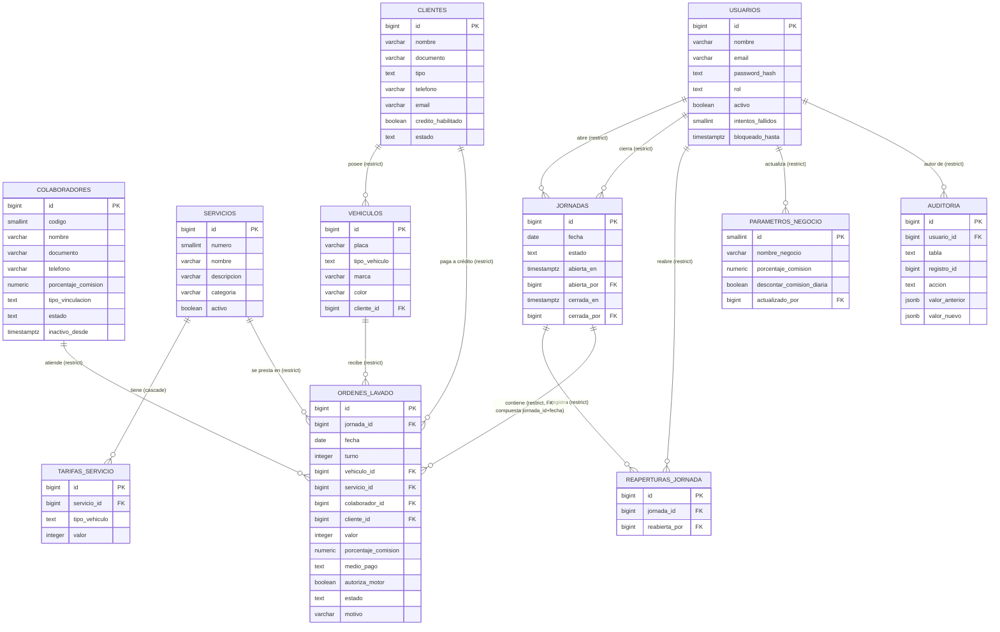

# Modelo de datos

Esquema de la base de datos del Car Wash, construido como migraciones versionadas de Supabase (`supabase/migrations/`). Este documento se actualiza al cerrar cada fase de SCRUM-145/SCRUM-146.

**Estado actual: Fase 2 (SCRUM-146) completa — 11 tablas.** El esquema queda cerrado: `usuarios`, `colaboradores`, `servicios`, `tarifas_servicio`, `clientes`, `vehiculos`, `jornadas`, `reaperturas_jornada`, `ordenes_lavado` (Fase 1) + `parametros_negocio`, `auditoria` (Fase 2).

## Diagrama entidad-relación

## Grafo de dependencias por niveles

El esquema es un grafo acíclico: cada FK apunta de un nivel mayor a uno menor. Verificado automáticamente por `estructura_test.sql` (chequeo 2: "No hay ciclos de llaves foráneas").

| # | Migración | Tabla o efecto | Depende de | Nivel | Fase |
| --- | --- | --- | --- | --- | --- |
| 01 | `crear_funciones_comunes` | `asignar_actualizado_en()`, `impedir_eliminacion()` | — | — | 1 |
| 02 | `crear_usuarios` | `usuarios` | — | 0 | 1 |
| 03 | `crear_colaboradores` | `colaboradores` | — | 0 | 1 |
| 04 | `crear_servicios` | `servicios` | — | 0 | 1 |
| 05 | `crear_tarifas_servicio` | `tarifas_servicio` | servicios | 1 | 1 |
| 06 | `crear_clientes` | `clientes` | — | 0 | 1 |
| 07 | `crear_vehiculos` | `vehiculos` | clientes | 1 | 1 |
| 08 | `crear_jornadas` | `jornadas` | usuarios | 1 | 1 |
| 09 | `crear_reaperturas_jornada` | `reaperturas_jornada` | jornadas, usuarios | 2 | 1 |
| 10 | `crear_ordenes_lavado` | `ordenes_lavado` | jornadas, vehiculos, servicios, colaboradores, clientes | 2 | 1 |
| 11 | `crear_reglas_ordenes_lavado` | triggers de órdenes | 10 | — | 1 |
| 12 | `crear_parametros_negocio` | `parametros_negocio` | usuarios | 1 | 2 |
| 13 | `crear_auditoria` | `auditoria` | usuarios | 1 | 2 |
| 14 | `activar_auditoria` | `registrar_auditoria()` y triggers | todas | — | 2 |

`usuarios` se adelanta a la Fase 1 (su historia es SCRUM-146) porque `jornadas` y `reaperturas_jornada` dependen de ella: así ninguna migración de la Fase 1 queda con una FK pendiente.

Notas de diseño:

- **`ordenes_lavado.cliente_id` y `vehiculos.cliente_id` no forman un ciclo.** Son dos rutas hacia `clientes` con significados distintos: quién paga a crédito (R8) frente a dueño del vehículo.
- **`ordenes_lavado.fecha` es redundancia controlada.** La API filtra por fecha y `UNIQUE (fecha, turno)` la necesita. La FK compuesta `(jornada_id, fecha) → jornadas (id, fecha)` impide que diverja de la fecha de su jornada.
- **`valor` y `porcentaje_comision` de la orden son copias históricas, no redundancia.** Congelan lo cobrado y la comisión vigente al crearla (R4 y SCRUM-142).
- **`jornadas.abierta_por`/`cerrada_por` son el *id* del usuario (FK a `usuarios`), no su email.** Hoy (API en memoria) estos campos guardan el email de `req.usuario` (ver ADR 0003); al migrar los services a Supabase (SCRUM-152) la API deberá enviar el `id` (el `sub` del JWT), no el email. Es un cambio de contrato ya anticipado aquí, no un error de esta migración.

## Qué valida la base de datos vs. qué valida la API

Principio de diseño: la BD solo protege invariantes de **dinero** y de **integridad estructural** (unicidad, existencia, formato). Las reglas que dependen de *secuencia en el tiempo* o de *quién hace la petición* siguen siendo responsabilidad exclusiva de la API, para no duplicar una misma regla en dos lugares que puedan desincronizarse.

| Regla | Descripción | La valida | Cómo |
| --- | --- | --- | --- |
| R1 | Vehículo, servicio y colaborador deben existir | BD | FK `ordenes_lavado_vehiculo_id_fkey` / `_servicio_id_fkey` / `_colaborador_id_fkey` |
| R2 | El colaborador asignado debe estar **activo** | API | `ordenesLavado.service.js` → `validarColaboradorActivo` (la BD no conoce "activo" al insertar/actualizar una orden) |
| R3 | El servicio debe estar activo y tener tarifa para el tipo de vehículo | Mixto | BD: `obtenerTarifaParaTipoVehiculo` se resuelve contra `tarifas_servicio` (si no existe tarifa, no hay valor que copiar). API: que el servicio esté `activo` sigue siendo responsabilidad de `calcularValorServicio` |
| R4 | El valor se fija una sola vez, desde la tarifa vigente, y nunca se recalcula | BD | Columna `valor` + trigger `proteger_orden_lavado` (rechaza cualquier `UPDATE` que lo cambie) |
| R5 | Un turno es único por fecha | BD | `ordenes_lavado_fecha_turno_key` |
| R6 | Un vehículo no puede tener más de una orden abierta a la vez | BD | Índice único parcial `idx_ordenes_lavado_vehiculo_abierta` |
| R7 | Los servicios con lavado de motor exigen autorización explícita | API | `validarAutorizacionMotor` (depende de `SERVICIOS_CON_LAVADO_MOTOR`, una constante de dominio, no de una columna) |
| R8 | `clienteId` solo se exige y procesa cuando el pago es a crédito, y el cliente debe tener crédito habilitado | Mixto | BD: `ordenes_lavado_credito_cliente_check` (coherencia medio_pago↔cliente_id) y `clientes_credito_solo_empresa_check` (crédito solo en empresas). API: que el cliente esté `activo` y realmente tenga `creditoHabilitado = true` en el momento de la orden sigue siendo de `resolverClienteCredito` |
| R9 | Las transiciones de estado siguen la máquina de estados del dominio (no se saltan ni retroceden pasos) | API | `TRANSICIONES_ORDEN` en `ordenesLavado.service.js` — la BD no conoce la máquina de estados, solo que una orden cerrada es inmutable (R10) |
| R10 | Una orden entregada o cancelada no puede volver a cambiar de estado | BD | Trigger `proteger_orden_lavado` (bloquea cualquier `UPDATE` si `old.estado in ('entregada','cancelada')`) y `impedir_eliminacion` (ninguna orden se borra) |

Además, el porcentaje de comisión de una orden (`porcentaje_comision`) se copia del colaborador al crearla y queda congelado — lo asigna el trigger `preparar_orden_lavado` e ignora cualquier valor que llegue en el `INSERT`; solo se recalcula si `colaborador_id` cambia mientras la orden sigue abierta (`proteger_orden_lavado`).

## Auditoría (Fase 2)

`registrar_auditoria()` corre `AFTER INSERT OR UPDATE OR DELETE` en **todas** las tablas de negocio (`usuarios`, `colaboradores`, `servicios`, `tarifas_servicio`, `clientes`, `vehiculos`, `jornadas`, `reaperturas_jornada`, `ordenes_lavado`, `parametros_negocio`) — nunca en `auditoria` misma, para no auditarse a sí misma (verificado por `estructura_test.sql`, chequeo 12).

- **Quién hizo el cambio**: `coalesce(request.headers->>'x-usuario-id', app.usuario_id)`. En producción, PostgREST llega con el primero (el `sub` del JWT, vía el header que envía la API); `app.usuario_id` es solo para pruebas y para el seed.
- **Qué acción quedó registrada**: `crear` (INSERT), `editar` (UPDATE), `eliminar` (DELETE) y, como excepción, `anular` cuando el UPDATE en `ordenes_lavado` cambia `estado` a `'cancelada'`.
- **Ruido descartado**: si un UPDATE solo cambia columnas técnicas (`actualizado_en`, `intentos_fallidos`, `bloqueado_hasta`), el trigger no inserta nada — evita llenar la auditoría de cambios de `actualizado_en` o de intentos de login fallidos.
- **Dato sensible excluido**: en `usuarios`, `password_hash` se quita del jsonb antes de guardarlo (ni en `valor_anterior` ni en `valor_nuevo`).
- **La auditoría es inmutable**: `UPDATE` sobre `auditoria` → `23514`; `DELETE` o `TRUNCATE` → `23001`. Ninguno de los dos se puede evitar con un rol superusuario, porque son triggers, no RLS.
- **`service_role` no escribe auditoría directamente**: solo la función `registrar_auditoria()` (que corre `security definer`) puede insertar en `auditoria`; `service_role` tiene `INSERT`/`UPDATE`/`DELETE`/`TRUNCATE` revocados sobre esa tabla.
