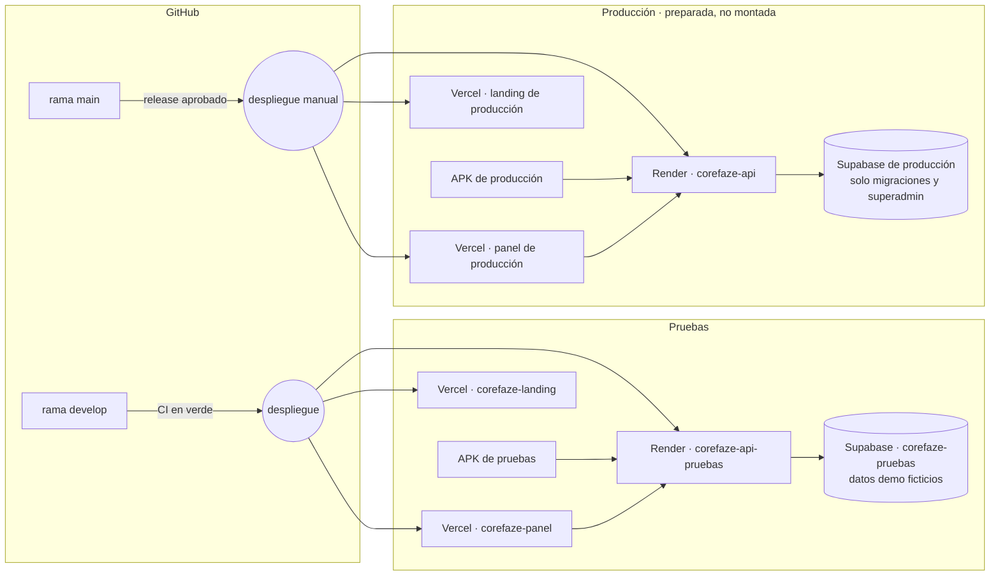

# Despliegue de Corefaze

Corefaze tiene dos entornos en la nube: **pruebas**, que ya está montado, y **producción**, que solo está
preparado. Esta guía cubre su arquitectura, las variables y los secretos, el flujo de ramas y releases, los
respaldos, el monitoreo, las pruebas rápidas y el plan de regreso. Al final está el procedimiento completo para
montar producción.

## Arquitectura



- **El navegador habla solo con la API.** Solo la API habla con Supabase, con la `service_role`.
- **La landing es estática**: no llama a la API.
- **La app móvil (APK)** llama a la API de su entorno.

## Entornos

| | Desarrollo | Pruebas | Producción |
|---|---|---|---|
| Rama | la de cada tarea | `develop` | `main` |
| Base de datos | Supabase local (`npx supabase start`) | Proyecto Supabase `corefaze-pruebas` | Proyecto Supabase propio, limpio |
| API | `npm run dev:api` | Render `corefaze-api-pruebas` (plan free) | Render `corefaze-api` (plan pago) |
| Panel y landing | `npm run dev:web` y `npm run dev:landing` | Vercel `corefaze-panel` y `corefaze-landing` | Vercel, en el dominio principal |
| App móvil | `config/desarrollo.json` | `config/pruebas.json`, pre-release de GitHub | `config/produccion.json` |
| Datos | demo ficticios | demo ficticios (`seed-demo.js` con `ENTORNO=pruebas`) | **nunca demo**: migraciones y superadmin |
| `ENTORNO` | `desarrollo` | `pruebas` | `produccion` |
| Despliegue | — | automático cuando el CI pasa | manual, con aprobación |

## Ramas y releases

1. Cada cambio va en su rama (`<tipo>/CW_<COMP>_<Integrante>_<Tarea>`) y entra a `develop` por PR, con el CI en verde.
2. Al fusionar en `develop`, Render y Vercel despliegan pruebas solos. Ahí se prueba.
3. Para publicar se abre un **PR de release de `develop` a `main`** y se fusiona con **merge commit** (nunca squash),
   para que las dos ramas no se separen.
4. Después de fusionar se crea la etiqueta `vX.Y.Z` en `main` (versionado semántico) con sus notas.
5. El despliegue a producción pide aprobación manual (GitHub Environment `produccion`).
6. `main` está protegida:
   - solo entra por PR;
   - con los checks obligatorios en verde;
   - con al menos 1 aprobación;
   - sin push directo ni force push.

### Checks de CI

| Workflow | Corre cuando cambia | Qué hace |
|---|---|---|
| `api.yml` | `apps/api`, `supabase`, `packages/contratos`, dependencias | lint, Supabase local, pruebas, `npm audit` (altas) |
| `web.yml` | `apps/web`, `packages/contratos`, dependencias | lint, pruebas, build, `npm audit` |
| `landing.yml` | `apps/landing`, dependencias | lint, pruebas, build, `npm audit` |
| `movil.yml` | `apps/movil`, `packages/contratos` | formato, `flutter analyze`, `flutter test` |
| `bd.yml` | `supabase` | migraciones + seed, pgTAP, `db lint` |

## Variables por servicio

Aquí van solo los **nombres**. Los valores de pruebas viven en un archivo `pruebas.env` fuera del repositorio, en
la carpeta de entrega del equipo; los de producción, en el gestor de secretos del equipo. Nada de esto se sube a
git.

### API (Render)

| Variable | Para qué | Secreta | Dónde vive |
|---|---|---|---|
| `NODE_VERSION` | Versión de Node (22) | no | `render.yaml` |
| `NODE_ENV` | Modo de Node: `production` en la nube | no | `render.yaml` |
| `ENTORNO` | `pruebas` o `produccion`. Sale en `/api/salud` y bloquea `seed-demo.js` en producción | no | `render.yaml` |
| `ALLOWED_ORIGIN` | Único origen permitido por CORS: la URL del panel de ese entorno | no | Render |
| `API_KEY_POSTMAN`, `API_KEY_ADMIN` | Llaves de cliente para herramientas internas | **sí** | Render |
| `API_KEY_WEB` | Llave del panel. También va en `VITE_API_KEY`, así que es pública: identifica, no protege | identifica | Render y Vercel |
| `API_KEY_MOVIL` | Llave de la app. Va dentro del APK y es pública por diseño | identifica | Render y APK |
| `JWT_SECRET` | Firma de las sesiones | **sí** | Render |
| `JWT_EXPIRES_IN` | Duración de la sesión (por ejemplo `8h`) | no | Render |
| `SUPABASE_URL` | URL del proyecto Supabase del entorno | no | Render |
| `SUPABASE_SERVICE_ROLE_KEY` | Acceso total a la base (salta RLS). **Solo en la API** | **sí** | Render |

`PORT` lo pone Render. `SUPERADMIN_NOMBRE`, `SUPERADMIN_EMAIL` y `SUPERADMIN_PASSWORD` **no** van en Render: solo
se usan una vez, en la máquina que corre `npm run seed:superadmin`.

### Panel (Vercel, proyecto con raíz `apps/web`)

| Variable | Para qué |
|---|---|
| `VITE_API_URL` | URL de la API del entorno, con `/api` |
| `VITE_API_KEY` | `API_KEY_WEB` del entorno (pública) |

### Landing (Vercel, proyecto con raíz `apps/landing`)

| Variable | Para qué |
|---|---|
| `VITE_PANEL_URL` | Enlace "Iniciar sesión" (URL del panel + `/ingreso`) |
| `VITE_CORREO_CONTACTO` | Correo del formulario "Agenda tu demo". Vacía: el formulario avisa que aún no envía |

Todas las `VITE_*` son **públicas**: quedan en el JavaScript que descarga el navegador.

### App móvil (`apps/movil/config/<entorno>.json`, fuera de git)

| Clave | Para qué |
|---|---|
| `API_URL` | URL de la API del entorno con `/api`. La variante de publicación exige HTTPS |
| `API_KEY` | `API_KEY_MOVIL` del entorno |

### Carga de datos demo (solo pruebas, desde una máquina del equipo)

`DEMO_API_URL`, `DEMO_API_KEY`, `DEMO_EMAIL`, `DEMO_PASSWORD`, `SUPABASE_URL`, `SUPABASE_SERVICE_ROLE_KEY` y
`ENTORNO=pruebas`. El script se niega a correr con `ENTORNO=produccion` o `NODE_ENV=production`.

### Encabezados de seguridad (Vercel)

`apps/web/vercel.json` y `apps/landing/vercel.json` mandan estos encabezados:

- `X-Content-Type-Options`;
- `Referrer-Policy`;
- `Permissions-Policy`;
- `X-Frame-Options: DENY`;
- una CSP ajustada a lo que carga cada sitio.

Hay dos cosas que cuidar con la CSP:

- **Panel:** `connect-src` nombra los hosts de la API (`corefaze-api-pruebas.onrender.com` y
  `corefaze-api.onrender.com`). Si Render asigna otro subdominio o se usa un dominio propio, hay que actualizarla.
- **Landing:** autoriza por hash su único script en línea (el que aplica el tema antes de pintar). Si ese script
  cambia, `src/cspVercel.test.js` falla hasta actualizar el hash.

## Secretos: generación y rotación

**Generación.** Siempre con `crypto` y al menos 32 bytes. Cada entorno tiene secretos **propios**: nunca se
reutilizan los de desarrollo ni se comparten entre pruebas y producción.

```bash
node -e "console.log(require('crypto').randomBytes(32).toString('base64url'))"
```

**Rotación** (por ejemplo si una llave se filtró, si alguien sale del equipo o, para producción, al menos cada
6 meses):

| Secreto | Cómo se rota |
|---|---|
| `API_KEY_*` | Se genera la nueva, se cambia en Render y en el cliente que la usa (Vercel o un APK nuevo), y se redespliega. La anterior deja de servir al instante |
| `JWT_SECRET` | Se cambia en Render y se redespliega. Todas las sesiones abiertas se cierran y la gente vuelve a ingresar |
| `SUPABASE_SERVICE_ROLE_KEY` | Se rota la llave en el panel de Supabase (API Keys), se actualiza en Render y se redespliega |
| Contraseña de la base | Supabase → Database → Reset password. Se actualiza donde se use la CLI |

**Dónde viven:**
- Pruebas: un archivo `pruebas.env` en la carpeta de entrega del equipo, fuera del repositorio.
- Producción: el gestor de contraseñas del equipo, nunca en archivos compartidos por chat.

## Respaldos

- **Antes de cada migración** en un entorno de la nube:
  ```bash
  npx supabase db dump --linked -f respaldo_<entorno>_<fecha>.sql
  npx supabase db dump --linked --data-only -f respaldo_<entorno>_<fecha>_datos.sql
  ```
  Esos archivos tienen datos reales y **nunca se suben** (`respaldo_*.sql` está en `.gitignore`).
- En producción se recomienda el **plan pago de Supabase**: respaldos diarios y restauración a un punto en el
  tiempo (complemento PITR). El plan gratuito no restaura a un punto en el tiempo y pausa el proyecto tras una
  semana sin uso.

## Monitoreo

En UptimeRobot, un monitor HTTP(s) por entorno:

- URL: `https://<api>/api/salud`;
- cada 5 minutos, con la palabra clave `"ok"`;
- alerta por correo al equipo.

`/api/salud` responde `{"estado":"ok","entorno":"pruebas"}`, sin datos sensibles. En pruebas, Render gratis se
duerme tras 15 minutos sin tráfico y tarda ~1 minuto en despertar. Para una demo hay que abrirla 2 minutos antes.

## Pruebas rápidas después de cada despliegue

1. `GET /api/salud` → `200` con el `entorno` correcto.
2. `GET /api-docs` carga.
3. Ingreso con el superadmin y con un usuario de cada rol (administrador, soporte, pendiente).
4. Solicitud de acceso y su aprobación.
5. Jornada: abrirla con el QR desde el APK y con "Abrir desde aquí".
6. Una orden creada desde el panel y otra desde el móvil. Cambiar sus estados, cobrarlas en caja y cerrar la caja.
7. Crédito, nómina, inventario y reportes cargan.
8. Landing: "Iniciar sesión" lleva al panel del mismo entorno.
9. Encabezados de seguridad y CSP presentes (`curl -I`), sin errores de CSP en la consola del navegador.

## Plan de regreso

- **API, panel y landing.** Se vuelve a la versión anterior con un clic:
  - Render: Deploys → la versión anterior → Rollback;
  - Vercel: Deployments → la versión anterior → Promote / Instant Rollback.
- **Base de datos.** Una migración **no se deshace**. Se corrige con una **migración nueva** que revierte el
  cambio. Si se perdieron datos, se restaura desde el respaldo tomado antes de migrar, o desde PITR en el plan pago.
- **App móvil.** Se publica de nuevo el APK anterior. La API debe seguir aceptando esa versión mientras haya
  equipos que la usen.

## Montar producción (cuando se acerque el primer cliente)

Antes de empezar, todos los puntos bloqueantes de [`checklist-primer-cliente.md`](checklist-primer-cliente.md)
deben estar resueltos.

### 1. Base de datos

1. Crear un proyecto Supabase **nuevo**, solo para producción. Región: São Paulo (`sa-east-1`), la más cercana a
   Colombia. Contraseña de la base generada con `crypto` y guardada en el gestor del equipo.
2. Elegir el plan pago (respaldos diarios; PITR opcional).
3. Vincular y aplicar las migraciones de `main`, **sin** seed:
   ```bash
   npx supabase link --project-ref <ref-de-produccion>
   npx supabase db push
   ```
4. Verificar las tablas, que RLS esté activo en todas y que existan las funciones. Si hay pgTAP, contra el remoto.
5. **No correr nunca** `seed.sql` ni `seed-demo.js`. Este último se niega a correr con `ENTORNO=produccion`.

### 2. Secretos

Generar con `crypto` y guardar en el gestor del equipo:

- `JWT_SECRET`;
- `API_KEY_POSTMAN`, `API_KEY_ADMIN`, `API_KEY_WEB` y `API_KEY_MOVIL`, todas nuevas.

### 3. API (Render)

1. En Render: **New → Blueprint** con este repositorio. `render.yaml` crea `corefaze-api` desde `main`, con plan
   pago y despliegue manual. Si `corefaze-api-pruebas` ya existe, Render la reconoce por nombre.
2. Cargar las variables con `sync: false`. `ALLOWED_ORIGIN` es el dominio del panel de producción.
3. Crear el superadmin, una sola vez, desde una máquina del equipo con `SUPERADMIN_*` y las variables de
   producción: `npm run seed:superadmin --workspace apps/api`. Contraseña fuerte y cuentas por persona después.
4. Revisar `/api/salud` → `{"estado":"ok","entorno":"produccion"}`.

### 4. Panel y landing (Vercel)

1. Crear dos proyectos de producción, desde `main`, con raíz `apps/web` y `apps/landing`.
2. Configurar las variables `VITE_*` con los valores de producción.
3. Configurar el dominio principal, con HTTPS automático.
4. Si la API usa un dominio propio, actualizar `connect-src` en `apps/web/vercel.json` antes del release.

### 5. App móvil

1. Crear la llave de firma (keystore) y respaldarla **fuera del repositorio**. Si se pierde, la app no se puede
   actualizar.
2. Compilar con `config/produccion.json`, con HTTPS:
   `flutter build apk --release --dart-define-from-file=config/produccion.json`.
3. Publicar como release de GitHub o en Play Store.

### 6. GitHub

1. Environment `produccion` con aprobación manual.
2. PR de release `develop → main` (merge commit), aprobación y etiqueta `vX.Y.Z`.
3. Desplegar `corefaze-api` (Manual Deploy) y promover los despliegues de Vercel.

### 7. Cierre

1. Pruebas rápidas completas en producción.
2. Monitor de UptimeRobot sobre `/api/salud` de producción.
3. Respaldo inicial (`supabase db dump`).
4. Anotar la versión publicada.
